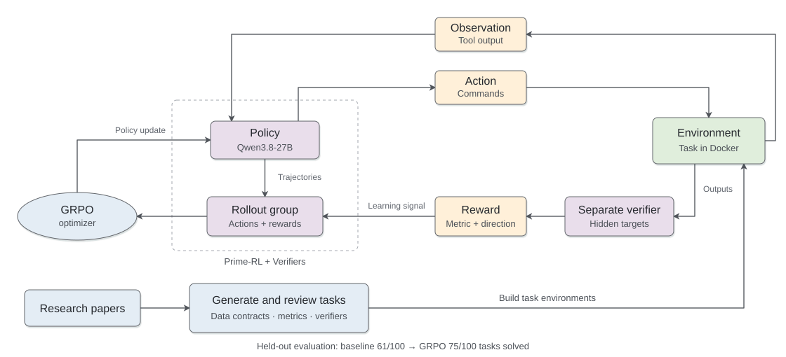

# Finance Task Pipeline: Research to Reinforcement Learning

I built an automated pipeline that turns financial research papers into
executable agent environments with task-specific data contracts, verifiers, and
rewards. I completed **Qwen3.8-27B GRPO training on cloud GPUs**, improving measured
success from **61/100 to 75/100 held-out tasks: +14 percentage points**.

Training tasks drive policy updates; validation tasks guide checkpoint selection.
The final comparison uses separate held-out tasks, with the same Docker execution,
verifiers, and success criteria for both models.

The engineering problem is defining what a correct financial output means. An
agent can write a valid file while violating the task's statistical requirements.
A forecast assigned to the wrong input window is incorrect even if its values
look plausible. A synthetic return path, however, need not reproduce a particular
held-out path: comparing unrelated samples row by row would reward the wrong
objective. I made that distinction explicit in the environment contract before
generating instructions, verifier code, or an RL reward.

For **forecasting**, the [contract](src/finpipe/contracts/task_types/forecasting.py)
requires training inputs and targets, test inputs, expected outputs, and withheld
test targets. Prediction row `i` must correspond to test-input and target row `i`.
The verifier measures predictive error on those aligned outputs; the contract's
example uses mean squared error (MSE).

For **unconditional return generation**, the
[contract](src/finpipe/contracts/task_types/generation.py) requires training
samples, generated outputs, and withheld reference samples. It does not require
training targets or test inputs. Assessment compares samples as distributions,
without assuming paired rows. The example uses **1-Wasserstein distance** to
measure marginal return-distribution error and **squared-return autocorrelation
error** to measure temporal dependence that a marginal comparison alone misses.
These are task-contract examples; each generated task carries its own metric
definitions.

I automated the path from a research paper to that executable contract. Paper
discovery, retrieval, and suitability screening feed task extraction, which
specifies the objective, dataset roles, sources, filenames, expected structures,
and metric inputs. A task critic reviews consistency between the task type,
data, and assessment. Deterministic
[structural checks](src/finpipe/review/rules.py) catch missing required datasets,
duplicate filenames, and metrics referencing unknown files. The generator then
produces retrieval scripts, agent instructions, a Python verifier, and
Harbor-compatible Docker definitions. Generated Python is linted, and Docker
builds run retrieval scripts to check that the expected files are produced.

The task semantics reach both sides of execution. Instructions request outputs
conditioned on test inputs only when those inputs exist.
[Verifier generation](src/finpipe/generation/prompts.py) receives the explicit
row-correspondence rule alongside output specifications, withheld targets, and
metric definitions. The solver and verifier run in separate Docker environments:
the solver receives training data and any test inputs; the grader holds the
assessment script and hidden targets. The agent uses a Bash harness to implement
its solution and writes submissions to `/logs/artifacts/`. The verifier executes
the task's numerical assessment and writes named scores to
`/logs/verifier/reward.json`.

For post-training, I integrated **Prime-RL + Verifiers** with GRPO and configurable
LoRA adaptation, reusing these tasks, Docker environments, and verifiers. The
[task manifest](rl/src/finpipe_rl/manifest.py) selects one existing `reward_key`
and declares whether to maximize or minimize it. The
[reward adapter](rl/src/finpipe_rl/taskset.py) applies weight **+1** to a metric to
maximize and **−1** to an error to minimize. For the contract examples, this gives:

| Selected metric | What the verifier measures | Scalar training reward |
|---|---|---|
| Forecasting MSE | Mean squared error between aligned predictions and withheld targets | `−MSE` |
| Return-generation Wasserstein distance | Distance between generated and held-out marginal return distributions | `−wasserstein` |
| Return-generation squared-return ACF error | Difference between generated and held-out squared-return autocorrelation functions | `−acf_error` |

Lower error therefore produces higher reward. Each task selects one of its
metrics for optimization; other scores remain available for evaluation. The
adapter preserves the metric's scale and does not combine these example metrics
into a new loss. GRPO compares rewarded rollouts within each task's group to
update the policy. Missing or nonfinite reward values and nonzero verifier exits
are rejected.

Evaluation success is defined separately by `success_key` and
`success_threshold`: a minimizing metric must fall at or below its threshold;
a maximizing metric must reach or exceed it. Execution failures count as
unsuccessful attempts. The **61% → 75%** result is the proportion of held-out
tasks solved under their success criteria, not an average of scalar rewards.

I built the operational controls around reproducibility, recovery, and evaluation
integrity:

- **Reproducibility:** frozen task manifests, digest-pinned solver/verifier images,
  and receipts recording model artifacts, framework revisions, integration code,
  and configuration identities.
- **Execution and recovery:** bounded parallel rollouts, timeouts and retries,
  native distributed launch, and recovery from complete trainer/orchestrator
  checkpoints with checks against changing the experiment on resume.
- **Evaluation integrity:** separation of declared paper/dataset provenance groups
  across splits, matched baseline/trained protocols, and execution failures kept
  in the success-rate denominator. Reports include task breakdowns and paired
  confidence intervals clustered by provenance.
- **Observability:** structured logs, optional experiment tracking, reward and
  training-stability summaries, native performance metrics, host-local GPU
  samples, and qualification reports derived from recorded artifacts.

| Completed cloud GPU experiment | Task success |
|---|---:|
| Qwen3.8-27B baseline | **61% — 61 of 100 held-out tasks** |
| Qwen3.8-27B after GRPO | **75% — 75 of 100 held-out tasks** |
| Improvement | **14 more tasks solved; +14 percentage points** |

The result compares the baseline with the GRPO-trained model; it does not isolate
the effect of environment design. Recorded local validation passed **164 repository
tests** and **57 framework contract tests**, with nine and one skipped respectively.
Lint, package, and documentation checks also passed.

The [technical report](docs/rl-results.md) covers the design rationale, dataset
split, results, and evidence scope. The [RL runbook](rl/README.md) contains the
operational documentation.
